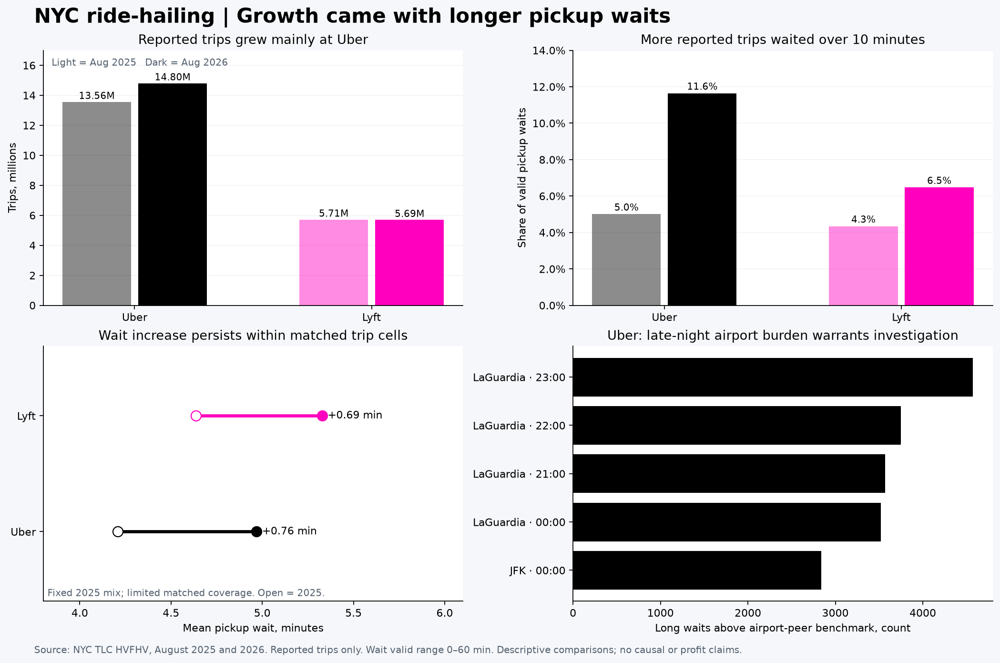

# NYC Ride-Hailing Marketplace Intelligence

**Did growth keep pace with pickup reliability—and where should operations investigate first?**

An independent business analytics project analyzing **39.8 million reported Uber/Lyft trips** from August 2025 and August 2026 using **Python and DuckDB SQL**.



*Static four-chart summary generated with Python/Matplotlib from validated SQL results. This image is not a Tableau screenshot. Gray/light pink represent 2025; black/bright pink represent 2026 in the top charts.*

## What the four charts show

| Chart | Business finding |
|---|---|
| **Trip volume** | Uber reported trips grew **9.16%**; Lyft trips declined **0.34%**. |
| **Long pickup waits** | Uber's >10-minute wait rate rose **5.00% → 11.64%**; Lyft's rose **4.34% → 6.47%**. |
| **Comparable-trip check** | Using fixed 2025 weights over matched trip cells, mean pickup wait increased **0.76 min for Uber** and **0.69 min for Lyft**. Coverage is limited; this is descriptive adjustment. |
| **Where to investigate first** | Late-night LaGuardia pickup windows carry substantial long-wait burden even against same-company airport peers. |

## Recommended decision

**Investigate late-night LaGuardia pickup operations before committing to a broader intervention.**

For Uber weekday pickups at **23:00–23:59**, the observed long-wait rate was **55.1%**, compared with a **25.5%** same-company airport-peer benchmark. That represents approximately **4,571 long waits above the benchmark** during the month, not a forecast of preventable delays or recovered revenue.

Check driver queues, dispatch acceptance, pickup access, flight arrivals and cancellations to identify the bottleneck. If the cause is controllable, propose a targeted operational pilot with wait, completion, rider-price, driver-earnings and incentive-cost guardrails. **No pilot, causal effect, revenue lift or cost saving was measured.**

[Read the full case study and recommendations](reports/CASE_STUDY.md)

## How the analysis was built

**Official trip records → validated SQL trip model → business metrics → comparison checks → four-chart decision brief**

1. **Acquire:** download two official monthly Parquet files and the taxi-zone lookup; record source URLs and SHA-256 checksums.
2. **Prepare:** identify companies, join pickup-zone names, derive time segments, and apply separate validity rules for wait, fare and pay metrics.
3. **Analyze:** aggregate activity and service metrics; calculate exact wait percentiles and decompose base-fare growth into volume, fare/mix and interaction contributions.
4. **Challenge the headline:** compare matched unpooled route/hour/day-type/distance-band cells using fixed 2025 weights; check fare-outlier and wait-cap sensitivities.
5. **Validate:** reconcile trip and valid-wait counts across summary, daily and segment tables; verify lookup uniqueness, date coverage, growth components and matched coverage.
6. **Communicate:** translate findings into a prioritized investigation, a conditional pilot proposal and explicit evidence limits.

## Metric definitions and limits

- **Reported trips:** records in the source files, not all ride requests or all NYC transportation activity.
- **Long-wait rate:** waits over 10 minutes divided by valid request-to-pickup waits of 0–60 minutes. Ten minutes is an analyst-selected threshold.
- **Base passenger fares:** exclude tolls, tips, taxes and fees; they are **not platform revenue**.
- **Matched comparisons:** require at least 100 valid unpooled observations per cell in each year. They cover a minority of trips and do not establish causal pricing or service effects.
- **Priority burden:** descriptive excess over an airport/non-airport peer benchmark; not achievable reduction or ROI.

Public records lack the full request funnel, customer/driver identifiers, idle time and expenses. Retention, cancellation rates, net driver earnings and platform profit cannot be estimated from this project.

## Code and supporting materials

- `sql/`: executed model, metric, sensitivity and chart-preparation queries.
- Python scripts: retrieval, analysis orchestration and visual reporting.
- `reports/CASE_STUDY.md`: detailed findings and business interpretation.
- `reports/source_manifest.json`: public source URLs and checksums.

Raw trip records, the local database, standalone CSV exports, logs, internal planning documents and resume materials are excluded. The four-chart preview contains aggregate findings only.

<details>
<summary>Tableau prototype and local reproduction</summary>

The [Tableau workbook](tableau/NYC_Ridehail_Three_Dashboards.twbx) is a supplementary prototype. It has known data-connection compatibility issues; it is not presented as a validated final Tableau dashboard. The four-chart image above is the primary visual summary of this analysis.

The workbook contains aggregate extracts, not individual trip records. Downloaders can inspect those aggregate values. Duplicate embedded CSVs are omitted.

To rebuild the analytical results locally, use Python 3.12 and sufficient disk space:

```sh
python -m venv .venv
source .venv/bin/activate
pip install -r requirements.txt
python fetch_data.py
python run_analysis.py
python make_report.py
```

The scripts regenerate detailed outputs locally; those data exports are excluded from version control. Checksum validation stops if TLC revises a source file. Tableau-generation scripts remain available as prototype code and require further connection repair before reliable editing/saving.

</details>

## Sources

[NYC TLC trip records](https://www.nyc.gov/site/tlc/about/tlc-trip-record-data.page) · [Official HVFHV field dictionary](https://www.nyc.gov/assets/tlc/downloads/pdf/data_dictionary_trip_records_hvfhs.pdf)

Inputs retrieved October 25, 2026. TLC cautions that reported records may be incomplete or inaccurate. Independent portfolio work; no affiliation with Uber, Lyft or TLC. No ML, forecasting, executed causal experiment, BigQuery or cloud pipeline is claimed.
